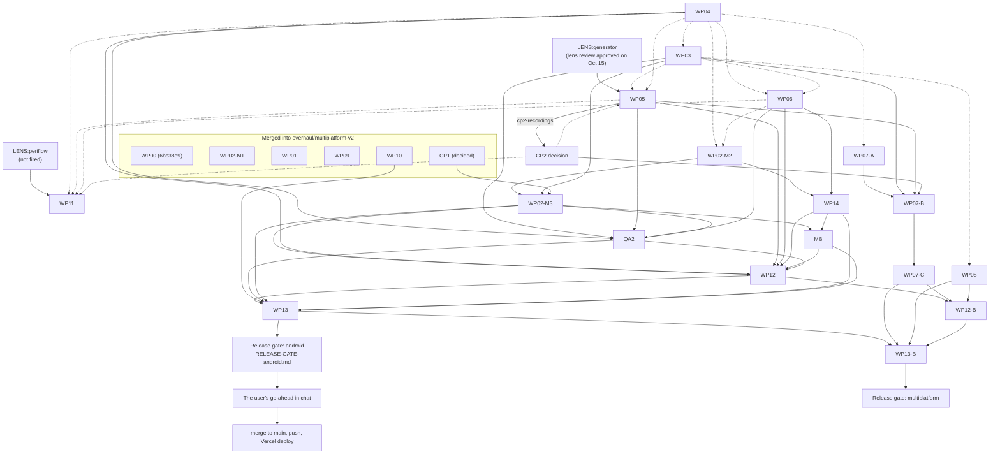

# Packages and branches of the android-base overhaul

State read from git on **Oct 16, 2026, 11:40 to 11:46 IST**, on the Linux laptop, before it was wiped. Written for
Claude on the new (Windows) machine and for the user. Read `HANDOVER.md` first. This file is the detailed map of:

- every git ref and every worktree;
- the package that owns each one, what it holds, and what remains;
- how the packages depend on each other, and the order they merge in;
- the release gate;
- how to restore the branches, worktrees and uncommitted work on the new machine;
- the Workflow scripts that drive the agents.

Companion documents in the same folder: `HANDOVER.md`, `REQUIREMENTS-STATUS-FINAL.md`, `RESUME-ON-WINDOWS.md`,
`CHAT-HISTORY.md`, `MANIFEST.md`, `WIPE-READINESS.md` and `PUSHED.md` (what the backup actually pushed: trust it over
the plan below where they differ).

---

## 0. Read this first

### 0.1 What was on GitHub when this was written

At 11:46 the public repo `github.com/tripathisarthak457/android-base` held **only `main`** (`99c4edf`). Every other
branch, the `merged/*` tags and the WIP snapshots were still local. The backup workflow (`scripts/handover-backup.js`,
run `wf_1b6fefc0-712`) pushes them **after** this file was written, in this layout:

| Where | What |
|---|---|
| `tripathisarthak457/android-base` (PUBLIC) | every branch except `main` (`main` stays untouched, because Vercel deploys it); the `merged/*` tags; the WIP snapshots as `backup/<name>-wip-2026-10-16`; the orphan branch `overhaul-workspace` (the curated `.overhaul/`, the handover docs, Claude's memory) |
| Draft release `overhaul-raw-data-2026-10-16` on the same repo (owner-only) | raw data too big for git (`gh release download overhaul-raw-data-2026-10-16 -R tripathisarthak457/android-base`) |
| `tripathisarthak457/periflow` (PRIVATE) | the branch `overhaul/smooth-glass` and its WIP snapshot `backup/smooth-glass-wip-2026-10-16` |

Check what really landed: `git ls-remote https://github.com/tripathisarthak457/android-base.git` and
`.overhaul/handover/PUSHED.md`.

### 0.2 Warning: a later workflow may have merged everything into `main`

`PROGRESS.md` (Oct 16, about 11:30) records that **the user asked for every branch to be merged into `main` and then
deleted**, in both repos. The user's words, quoted there: "u merge it pls i get confused in lots of branches will stop
vercel to deploy that we will do after testing". The script `scripts/merge-all-to-main.js` does this (see §9.3). It was
planned to start **after** the backup workflow finished, and it was **not running** when this file was written.

If it ran, the layout below has changed:

- `main` contains everything, merged **without review**, including the WIP snapshots, which do not compile;
- the branches are deleted;
- every former branch head is kept as the annotated tag `archive/<branch>-2026-10-16`;
- Vercel deploys from `main` are paused in `vercel.json` (`git.deploymentEnabled.main = false`);
- the workspace is in `main` under `overhaul-workspace/`.

**How to tell:** run `git ls-remote --heads https://github.com/tripathisarthak457/android-base.git`. Only `main`
listed, plus `archive/*` tags, means it ran. Then read `.overhaul/handover/MERGE-ALL-android-base.md` and
`MERGE-ALL-periflow.md`. That workflow's Docs phase is also meant to update this file; if it did not, use §8.7 to map
every name below to its archive tag.

### 0.3 Path conventions

The workspace root is one folder, called `tools/` here, with `android-base/` and `.overhaul/` side by side. Paths in
this file are relative to it unless they start with `/`.

| Name | Relative path | Old Linux absolute path |
|---|---|---|
| Workspace root | `tools/` | `/home/crazyhusir/Documents/projects/tools` |
| Repository (main checkout) | `android-base/` | `/home/crazyhusir/Documents/projects/tools/android-base` |
| Workspace (not in git on Linux) | `.overhaul/` | `/home/crazyhusir/Documents/projects/tools/.overhaul` |
| Package worktrees | `.overhaul/wt/<name>/` | `/home/crazyhusir/Documents/projects/tools/.overhaul/wt/<name>` |
| PeriFlow (private; suggested place: next to `tools/`) | `../jorwen/periflow/` | `/home/crazyhusir/Documents/projects/jorwen/periflow` |
| Claude's project memory | `~/.claude/projects/<slug>/memory/` | `/home/crazyhusir/.claude/projects/-home-crazyhusir-Documents-projects-tools/memory` |
| Google's Android skills plugin | `~/.claude/plugins/marketplaces/android-skills/` | `/home/crazyhusir/.claude/plugins/marketplaces/android-skills` |
| Workflow journals (old session) | `~/.claude/projects/<slug>/<session>/subagents/workflows/<run id>/journal.jsonl` | `/home/crazyhusir/.claude/projects/-home-crazyhusir-Documents-projects-tools/e3f9060d-6364-4a81-a9a2-20851e25521f/subagents/workflows/<run id>/` |

"Integration" or "INTEG" below always means the branch `overhaul/multiplatform-v2`.

---

## 1. Every ref at a glance

"Ahead / behind" = `git rev-list --count overhaul/multiplatform-v2..<ref>` / `git rev-list --count
<ref>..overhaul/multiplatform-v2`, measured at 11:40. "Dirty" = lines of `git status --porcelain` in the worktree.

| Ref | Owner | Head | Head date | Ahead / behind INTEG | Worktree | Dirty | WIP snapshot branch (expected name) | State |
|---|---|---|---|---|---|---|---|---|
| `main` | production (Vercel) | `99c4edf` | Sep 24 | 0 / 233 | none | n/a | none | untouched; equals `origin/main` |
| `overhaul/multiplatform-v2` | orchestrator (integration) | `a402d87` | Oct 14 17:54 | 0 / 0 | `android-base/` | 0 | none | WP00, WP02-M1, WP01, WP09, WP10 merged |
| `wp/WP01` | WP01 | `d19f79c` | Oct 9 08:34 | 0 / 188 | `.overhaul/wt/WP01` | 0 | none | **merged** (`merged/WP01`) |
| `wp/WP02` | WP02 (M1, M2, M3) | `13eb1f1` | Oct 15 16:25 | 44 / 0 | `.overhaul/wt/WP02` | 0 | none | M1 merged; M2 accepted, waiting on WP04 and WP06; M3 not started |
| `wp/WP03` | WP03 | `b595f9d` | Oct 15 16:18 | 79 / 0 | `.overhaul/wt/WP03` | **47** | `backup/WP03-wip-2026-10-16` | in progress; the WIP sheet system does not build |
| `wp/WP03-skel` | side branch for WP03 (REQUIREMENTS 34) | `46ec781` | Oct 14 18:53 | 78 / 153 | `.overhaul/wt/WP03-skel` | 0 | none | review APPROVED; fully contained in `wp/WP03`; phone verification pending |
| `wp/WP04` | WP04 | `fb866b3` | Oct 16 10:38 | 95 / 0 | `.overhaul/wt/WP04` | 0 | none | in progress: phase 3f gates; perf escalation open |
| `wp/WP04-perf` | side branch for WP04 (deep smoothness) | `fb866b3` (same commit as `wp/WP04`) | Oct 16 10:38 | 95 / 0 | `.overhaul/wt/WP04-perf` | **4** | `backup/WP04-perf-wip-2026-10-16` | round 2 in progress |
| `wp/WP05` | WP05 | `5d515a0` | Oct 15 15:37 | 15 / 153 | `.overhaul/wt/WP05` | 0 | none | glass foundation and tap lens done; waiting on WP03 and WP04 |
| `wp/WP05-glass` | side branch for WP05 (REQUIREMENTS 37) | `282dd3c` | Oct 15 15:53 | 170 / 0 | `.overhaul/wt/WP05-glass` | **43** | `backup/WP05-glass-wip-2026-10-16` | in progress; the WIP did not compile at the last try |
| `wp/WP06` | WP06 | `a8129c4` | Oct 15 16:15 | 32 / 0 | `.overhaul/wt/WP06` | 0 | none | waiting on WP04 and WP03 |
| `wp/WP07` | WP07 (A, then B and C) | `99239af` | Oct 12 14:16 | 15 / 153 | `.overhaul/wt/WP07` | 0 | none | phase A waiting on WP04 |
| `wp/WP08` | WP08 | `d05a682` | Oct 15 15:33 | 65 / 0 | `.overhaul/wt/WP08` | 0 | none | done except one step that waits on WP03 |
| `wp/WP09` | WP09 | `3d580cd` | Oct 9 17:05 | 0 / 154 | `.overhaul/wt/WP09` | 0 | none | **merged** (`merged/WP09`) |
| `wp/WP10` | WP10 | `d702b16` | Oct 14 17:37 | 0 / 1 | `.overhaul/wt/WP10` | 0 | none | **merged** (`merged/WP10`; the 1 "behind" is the merge commit itself) |
| PeriFlow `overhaul/smooth-glass` | WP11 | `45b91a2` | Oct 15 16:12 | 16 ahead of PeriFlow `main` (`240871f`) | `.overhaul/wt/WP11` | **2** | `backup/smooth-glass-wip-2026-10-16` (PRIVATE repo) | lens gate open; a user decision is pending |
| PeriFlow, detached `a5b630a` | WP11 baseline | `a5b630a` | Oct 10 11:54 | on `overhaul/smooth-glass` | `.overhaul/wt/WP11-base` | 0 | none | clean checkout, used to build the "before" APK |
| android-base, detached `28cd271` | scratch | `28cd271` | Oct 9 | on no branch | `.overhaul/scratch/WP09-trial` | 0 | none | a trial merge; low value (§3.16) |

Full SHAs (for checking a restore):

```text
99c4edf97570a117811fe21acde740570c14cfb5  main
a402d87e45057c22fe21ad9d7371c3885c8cf86d  overhaul/multiplatform-v2
d19f79c8aec111dad2378814b9bcc5bc2a0a2a36  wp/WP01
13eb1f14c9ebf524902b2cf8038ed94043032562  wp/WP02
b595f9d05695a132219b263960013c577a2a96e7  wp/WP03
46ec781bf54fc6331d932f4e0b349683ed18b8be  wp/WP03-skel
fb866b3b7a3095b2c72a7b2449f48737448191c7  wp/WP04
fb866b3b7a3095b2c72a7b2449f48737448191c7  wp/WP04-perf
5d515a0689decc31eb113461a7963bfccff38aa8  wp/WP05
282dd3c2856e6281697a49bfb9f9b00b06a78f67  wp/WP05-glass
a8129c4908a912b3922a33bec2b2855dc6bcf4b2  wp/WP06
99239af414735f2a9c8fc0cd7037514be4f6ef00  wp/WP07
d05a6828a6075c67859c1ac2037af6cd53350f8d  wp/WP08
3d580cdd7d30beac0159357a0e5ed9f12a24a44c  wp/WP09
d702b16fb5949bae3809bea90d6a94be0c77a05d  wp/WP10
709612df558029712e12aa5f6852236908186e9c  tag merged/WP01
54d078d79590b0a1a112aa526284ca91c2d65241  tag merged/WP02-M1
8672003e10629a82f519a7b2e9dd7f16766d3f91  tag merged/WP09
a402d87e45057c22fe21ad9d7371c3885c8cf86d  tag merged/WP10
45b91a207097f47b8f5423dc67ca35e0cb705a9b  periflow overhaul/smooth-glass
a5b630aa20d32341fc5a91e65dfd7462215a6e96  periflow WP11-base (detached)
240871f6160fc0eea748fae500d61423a28a6915  periflow main
```

Containment facts that matter for merging:

- `wp/WP03` contains every commit of `wp/WP03-skel` (0 commits of the side branch are missing from it).
- `wp/WP04` and `wp/WP04-perf` point at the same commit.
- `wp/WP05-glass` contains all of `wp/WP05`. It also merged `wp/WP04` at `3c9c403` and `wp/WP03` at `285275d`. Since
  then, `wp/WP04` has gained 10 commits and `wp/WP03` 11 that `wp/WP05-glass` does not have.
- `wp/WP01`, `wp/WP09` and `wp/WP10` are ancestors of the integration branch.

---

## 2. The `merged/*` tags

Lightweight tags on the integration branch's merge commits. **They are the signal every agent and script reads to
learn what has merged** (`git -C android-base tag -l 'merged/*'`). `to-release.js` pre-fires the same set (§5.1).

| Tag | Commit | Date | Merge commit subject |
|---|---|---|---|
| `merged/WP02-M1` | `54d078d` | Oct 9 07:35 | Merge WP02-M1: pure-Kotlin core, non-blocking MVI and module api packages |
| `merged/WP01` | `709612d` | Oct 9 08:37 | Merge WP01: generator engine v2, spec v2, catalogue v2 and token pipeline |
| `merged/WP09` | `8672003` | Oct 9 17:16 | Merge WP09: web API per target, opaque spec precheck and anonymous telemetry v2 |
| `merged/WP10` | `a402d87` | Oct 14 17:54 | Merge WP10: website configurator, previews, telemetry client and admin portal |

WP00 has no tag. It is the direct commit `6bc38e9` on the integration branch ("Move the Android template to
templates/android and seed the chrome contract", Oct 9 03:40). Each merge's checks are logged in `.overhaul/merges.md`
and `.overhaul/out/integration/<id>/`.

---

## 3. Each branch in detail

Each package's living record is `.overhaul/handoff/<id>.md`. A `## Progress` section at its top is kept current by
the agents. `<id>-RESUME.md` briefs (written Oct 14 to 16) give the exact state and the next three steps. The package
specifications are `.overhaul/design/wp/WP00.md` … `WP14.md`; the plan is `.overhaul/design/MASTER-PLAN.md`
(218 KB: grep a heading, then read a line range).

"Last review" means the last **fresh-context Google/AOSP-bar review** of the package (REQUIREMENTS 27). Review results
are not in git. They are in the workflow journals (`<run>/journal.jsonl`, `"type":"result"` records with a `verdict`
field), which are in the offline backup, not on GitHub.

### 3.1 `main`

- **Head:** `99c4edf` "Keep text on every brand colour at AA contrast, whatever accent is chosen" (Sep 24), the same
  as `origin/main`.
- **Purpose:** production. Vercel builds `android-base.vercel.app` from it.
- **Rule:** no agent merges or pushes to `main`. The Android release reaches `main` only after the release gate says
  GO **and** the user gives an explicit go-ahead in chat (§6). The one exception is the user's own Oct 16 request
  in §0.2.
- 233 integration commits are not on `main`.

### 3.2 `overhaul/multiplatform-v2` (the integration branch)

- **Head:** `a402d87` "Merge WP10: website configurator, previews, telemetry client and admin portal" (Oct 14 17:54).
- **First-parent history since `main`:** `6bc38e9` WP00 → `54d078d` WP02-M1 → `709612d` WP01 → `8672003` WP09 →
  `a402d87` WP10.
- **Checked out in:** the main clone `android-base/`. The integrator agent of `to-release.js` merges packages here
  with `--no-ff`, runs the integration checks, tags `merged/<id>` and appends to `.overhaul/merges.md` (§5.5).
- **Why it exists:** every package merges into it, so `main` stays deployable until the Android release passes its
  gate.

### 3.3 `wp/WP01`: generator engine v2, spec v2, catalogue v2, token pipeline (merged)

- **Head:** `d19f79c` "Wrap the over-long lines this branch added to the SDK check and the token schema" (Oct 9 08:34).
  Merged as `709612d` (`merged/WP01`), Oct 9 08:38.
- **Reviews:** three rounds (5, then 3, then 2 blocking findings), each followed by a fix run. The leftovers of
  review 3 are recorded under Deviations 21-23 and Open issues of `handoff/WP01.md`. At the merge, 249 generator tests
  passed.
- **Remaining:** nothing on this branch. The worktree is kept only for reference.

### 3.4 `wp/WP02`: Android architecture, MVI and build (three milestones on one branch)

- **Head:** `13eb1f1` "Fail a feature's scroll container that the chrome does not pad" (Oct 15 16:25). 44 ahead,
  0 behind (the integration branch was merged in as `4150f8b`).
- **Milestones:**
  - **M1** is merged (`54d078d`, `merged/WP02-M1`, Oct 9; review APPROVE).
  - **M2** is the `to-release.js` package `WP02-M2`.
  - **M3** is the package `WP02-M3`, not started.
- **Shared with a workflow:** `scripts/android-skills-v1-0-15.js` commits on this branch too (REQUIREMENTS 38:
  feature-aware vendoring of Google's Android skills). Its commits must be reviewed as WP02-M2's own.
- **Done (M2):**
  - `accept.sh` ACCEPT OK at `503c610` (Oct 10).
  - Modular `:api`/`:impl` generation; `verifyCodeRules`; Kotlin 2.4.21 and the other version bumps; vendored Android
    skills; the R8 analyzer docs; test fixtures.
  - The scaffolder's share of REQUIREMENTS 34 (`chromeContentPadding`, bones sized by a transparent line of text).
  - Import sorting; the `scroll-chrome` rule (`13eb1f1`).
  - At `13eb1f1`: 305 generator tests OK and the full consistency matrix green (147 projects, 0 new issues).
- **Last review:** M2 has **not** had its fresh-context review. `to-release.js` reviews a package only after it
  returns `done`, and M2 has been `waiting` since Oct 10.
- **Remaining (`handoff/WP02-M2-RESUME.md` §2):**
  - Merge the integration branch once WP04 and WP06 have merged. `git merge-tree` predicted 11 conflicting files
    against WP04, 27 against WP06 and 8 against WP03.
  - After that merge: `verifyCodeRules`, lint and the manifest rules, with every feature on.
  - Scaffold on WP04's chrome contract; database scaffolding in WP06's shape; `sharedTransitions` (Deviation 10).
  - Review the skills workflow's commits.
  - Re-accept.
- **Depends on:** WP04 and WP06 merged. WP03 does not block. M3 starts after WP02-M2, WP03 and CP1.
- **Uncommitted:** none.

### 3.5 `wp/WP03`: Android design system and catalog

- **Head:** `b595f9d` "Merge overhaul/multiplatform-v2 (WP10) into wp/WP03" (Oct 15 16:18). 79 ahead, 0 behind.
  It contains all of `wp/WP03-skel`.
- **Done (committed):**
  - Phase A; the call-site sweep (`1b7205f`); phase B with the CP1 tokens (`974d089`) and the optional groups as
    features (`a7f18df`).
  - The pull to refresh rebuilt (REQUIREMENTS 29: 0.54% janky in light, 0.67% in dark on the Redmi).
  - The research and QA items.
  - The shimmer fix through `wp/WP03-skel` (REQUIREMENTS 34).
  - The sheet tokens (`285275d`).
- **Uncommitted, to become `backup/WP03-wip-2026-10-16`:** 47 porcelain entries: 34 tracked files changed or
  deleted, plus 13 untracked entries that expand to 98 files. This is the **SHEET-SPEC revision 2 bottom-sheet system**
  (REQUIREMENTS 33, `research/SHEET-SPEC.md` §19.1):
  - New `core/designsystem/.../component/sheet/**` (81 files):
    - `AppSheet`, `AppSheetState`, `SheetAnchors`, `SheetController`, `SheetHost`, `SheetModality`;
    - `gesture/` (`SheetFlingBehavior`, `SheetCatch`, `SheetNestedScroll`, `SheetReleaseRule`, `SheetStretch`);
    - `layout/` (17 files), `surface/`, `chrome/`, `content/`, `stack/`, `choice/`, `action/`, `back/`, `shape/`;
    - about 20 sheet tests.
  - The overlay host: `AppBottomSheet.kt`, `OverlayHostNodes.kt`.
  - Six shell seams in `foundation/layout/`: `BarFrame`, `EntryVisibility`, `HostMotion`, `PaneBounds`,
    `PresentationLevel`, `ShellSeamApi`.
  - `text/TextScale.kt` (D11, D12).
  - The catalog's Sheets page (`catalog/.../sections/sheets/`, 19 demos).
  - `LocalSheetSurface` call sites; D10; K3 (the Utility style's bar `Floating`).
  - Strings in 5 languages (de, es, fr, hi, pt-BR); `tokens/styles.json`; `web/frontend/lib/catalogue.json`.
  - `abiValidation` in `core/designsystem/build.gradle.kts`.
  - Deleted: the old `overlay/AppSheet.kt` and `AppSheetState.kt`, and `core/navigation/.../SheetScene.kt`.
- **Build state of that WIP: not green.**
  - The last full test (Oct 14 18:13, `out/WP03/logs/r12-t4.log`) failed to compile: `syncAnchors` is unresolved at
    `component/sheet/gesture/SheetFlingBehavior.kt:88`. Three files were edited after that and never compiled.
  - Run 14 (Oct 15 20:55, `out/WP03/logs/r14-t1.log`) stopped earlier, at configuration:
    `core/designsystem/build.gradle.kts:25` uses the deprecated `included` in the `abiValidation` filter, and warnings
    are errors. So the Kotlin compile was not reached. The sheet code-rule tests in the same run passed
    (`RULES EXIT 0`).
  - **First fixes, in order:** `included` → `include` at `build.gradle.kts:25`; then `SheetFlingBehavior.kt:88`, if
    it still fails (`internal fun AppSheetState.syncAnchors` lives in `component/sheet/SheetAnchors.kt`).
- **An older copy of the WIP:** `.overhaul/backup/WP03-2026-10-15/` (`tracked.diff`, `untracked.tgz`,
  `stash-hash.txt`; it is in the `overhaul-workspace` branch). It is older than the WIP snapshot branch; use it only
  as a fallback.
- **Last review:** no package-level review yet. Its side branch `wp/WP03-skel` was APPROVED (§3.6).
- **Remaining (`handoff/WP03-RESUME.md` §2, `handoff/WP03.md` "Remaining work"):**
  1. Compile, get `testDebugUnitTest` green, and commit in steps: the sheet system and its call sites; the catalog
     Sheets page; D10; D11 and D12; K3.
  2. The `api/` dump, checked against SHEET-SPEC §4; the §15.5 screenshots; the §10.4 budgets; the compiler metrics.
  3. The sheet code rules go into WP02-M2's `verifyCodeRules` when the second of WP02-M2 and WP03 merges.
  4. `out/WP03/accept.sh`; the phone (the CP1 sheet and toast, catalog shots, K12).
  5. After WP04 merges: the conflicts and steps 1-6 of "When WP04 is merged"; M-1, M-2 and M-3 from
     `handoff/WP03-skel.md`; K4 and K14.
  6. The findings of the Compose performance audit (`research/COMPOSE-PERF-AUDIT.md`, not written yet).
- **Depends on:**
  - WP04 merged (the shell seams of SHEET-SPEC §19.2 and the `AppSheetNavHost` demos);
  - WP02-M2 (`verifyCodeRules`);
  - the phone;
  - CP2 (the glass sheet values).
- **Reference merge resolution:** `282dd3c` on `wp/WP05-glass` already merged WP03 on top of WP04: 21 conflicted
  files, with the decisions recorded in `handoff/WP05-glass.md` §2.0 and §2.1. The real WP03-after-WP04 merge will
  meet the same conflicts, so reuse it.

### 3.6 `wp/WP03-skel`: side branch, the shimmer and clipping fix (REQUIREMENTS 34)

- **Head:** `46ec781` "Merge wp/WP03 into wp/WP03-skel" (Oct 14 18:53). 78 ahead, 153 behind. Every one of its
  commits is already in `wp/WP03`.
- **Made by:** `scripts/shimmer-fix-from-report.js`, from `wp/WP03`. It holds one band across all placeholders, a
  `Modifier.Node` skeleton, zero recomposition per frame, and the WP03-owned clipping fixes.
- **Review:** three rounds, with 5, then 4, then **0** blocking findings: **APPROVE** (journal of `wf_b8570cc1-22c`).
- **Merged by WP03:** a fast-forward, then `b595f9d` on top.
- **Remaining:**
  - The workflow's Verify phase: before/after on the phone. `qa/shimmer/VERIFY.md` does not exist yet.
  - Items routed to owners (`handoff/WP03-skel.md`, "Open, and who takes it"):
    - **M-1** gates the WP03-after-WP04 merge: port `SkeletonNode.follow()` to WP04's `TabVisibility`
      (`.isVisible`).
    - M-2, M-3 (for whoever merges WP03 after WP04).
    - WP06's `DevToolsPanel` `contentPadding`; WP04's `AppScaffold` horizontal inset; WP02-M3's `SearchScreen`
      cross-fade (K5).
    - Regenerating WP08's Swift tokens; WP12's release-notes line; test-strength items.

### 3.7 `wp/WP04`: Android navigation, shell and performance harness

- **Head:** `fb866b3` "Lower a hidden tab's lifecycle the frame after the switch" (Oct 16 10:38). 95 ahead,
  0 behind. It includes `730f8e0`, the merge of `wp/WP04-perf`'s round 1.
- **Done:**
  - Phases 1 and 2; CP1 decided (`decisions/CP1.md`).
  - The back card, back during a push (REQUIREMENTS 32), QA-02…09.
  - The perf tooling (`templates/android/tools/perf/perf.sh`, `gates.toml`); the predictive-back recordings
    (REQUIREMENTS 24); `LocalNavigationSettled`.
  - Baseline profiles (`c14848d`).
  - REQUIREMENTS 34 in four commits (`7a50e56`, `fe182db`, `dc5c26c`, `3ff25f8`).
  - Round 1 of the first-frame fixes (via `wp/WP04-perf`) and the `KeptTabs` fix (`fb866b3`).
- **When it stopped:** run 20 was running `out/WP04/r20-chain.sh`: accept-local, the three presets, the REQUIREMENTS
  34 and D9 "after" shots, and `phone-gates.sh phase3f`. Its first step started at 10:48:33
  (`out/WP04/logs/r20-chain.log`). `r20-accept-local.log` stops mid-build at 10:50 (`:app:kspDevBenchmarkReleaseKotlin`)
  with no result, so the laptop went down during it. **Nothing of run 20 finished:** no accept-local result, no
  phase 3f, no "after" shots. Run 19 (`r19-accept-local.log`, 10:41) was cut off the same way.
- **Last review:** none yet (the package has not returned `done`).
- **Open, the important one: the perf ESCALATION** (`handoff/WP04.md`, Open issues, first item).
  - The `solid`, `standard` and `lean` gates cannot all pass. The frame that starts each transition from idle misses
    the 13.67 ms deadline because the CPU and GPU start at idle clocks.
  - `FABLE-FINDINGS.md` corrects the earlier plan: ADPF hints do not help on this phone. The only lever is a cheaper
    first frame.
  - The round-2 "floor" build decides it: if the fixed build is close to the floor, the rest is a device limit, to be
    recorded in the release gate.
  - Options (a), (b) and (c) need an orchestrator ruling before `accept.sh` passes its `perf.sh --gate` line.
- **Remaining:**
  - Phase 3f on the phone and the Measurements section.
  - The REQUIREMENTS 34 acceptance shots.
  - After WP03 merges: REQUIREMENTS 33 / SHEET-SPEC §19.2 (`Presentation.Sheet`, `presentation/sheet/*`, the card
    stack, the seams).
  - The WP04 items in `followups.md`; `accept.sh`.
- **Depends on:** nothing to merge first (it is first in the merge order). It needs the phone and the escalation
  ruling.

### 3.8 `wp/WP04-perf`: side branch, deep smoothness

- **Head:** `fb866b3`, the same commit as `wp/WP04`. WP04 merged round 1 (`730f8e0`), then took the uncommitted
  `KeptTabs.kt` change as its own commit `fb866b3`, so the two branches converged.
- **Uncommitted, to become `backup/WP04-perf-wip-2026-10-16`: 4 files, +49 lines.**
  - Files: `templates/android/feature/sample/src/main/kotlin/com/base/app/feature/sample/detail/SampleDetail{Contract,Route,ViewModel}.kt`
    and `src/test/.../SampleDetailViewModelTest.kt`.
  - What it does: the detail screen's "related" rows load only once `LocalNavigationSettled` says the push has
    settled (a new `LoadRelated` event). Before, they composed 185 composables 220 ms into every push.
  - Earlier notes say "5 files": the fifth was `KeptTabs.kt`, now `fb866b3`.
  - `handoff/WP04.md` (run 18) says this change belongs to **WP02-M3** (the sample feature) and stays on this branch
    until then.
- **Done:**
  - Root cause: nearly all remaining jank is the first frame after idle (`handoff/WP04-perf.md` §1,
    `FABLE-FINDINGS.md` §1).
  - Fixes `6436b75` (the leaving entry keeps its pane context), `1ec7462` (the tap handler reads the selection
    through state), `b7e8074` (the pill is a rounded rect), `ac56e69` (one background fill), and `fb866b3`.
  - The round-2 phone measurement finished Oct 16 at 10:27 (`out/WP04-perf/logs/measure2.log`; runs in
    `perf/WP04-perf/everything/`, traces in `everything-trace/`, `fixed-trace/`, `fixed-startup/`). **It has not
    been analysed yet.**
- **Last review:** none yet (the workflow had not reached its review loop).
- **Remaining:**
  - Analyse HEAD against the fixed build and the floor build; decide whether the rest is a device limit.
  - Commit the sample-detail change, or hand it to WP02-M3.
  - Run the jetpack-compose-performance audit over the shell.
  - Up to 3 review rounds; then WP04 merges it.
- **Merged by:** WP04 (`git merge wp/WP04-perf`). The last line of `handoff/WP04-perf.md` says so.

### 3.9 `wp/WP05`: optional liquid glass (`liquidglass` feature)

- **Head:** `5d515a0` "Give the tab lens's state a file of its own" (Oct 15 15:37). 15 ahead, 153 behind.
- **Done:**
  - The glass foundation: `GlassQuality` tiers, `SceneBackdrop` recording the scene once, `GlassSurface`,
    `LiquidLens`.
  - Kyant backdrop 2.0.1 and shapes 1.2.1 behind `<opt:liquidglass>` (`d549b2a`).
  - The REQUIREMENTS 35 travelling tap lens (`904a2a8`…`5d515a0`); 89 module tests pass.
- **Last review:** the lens fix (`review:lens-generator`) was **APPROVED** at `5d515a0` (release run
  `wf_0f44e8ee-3dc`, Oct 15). No package-level review yet.
- **Remaining:** `handoff/WP05.md` "What remains", items 1-10:
  1. `LiquidTabs`; 2. tokens; 3. the shell stage; 4. settings and dev extras; 5. the `kyant` code rule;
  6. `CatalogGlass`; 7. `GlassBenchmark`, gates and fixtures; 8. the feature's `owns` list; 9. the phone gates;
  10. the CP2 recordings.

  Items 1-3 are largely being built on `wp/WP05-glass`. Also: `SceneBackdrop` keyed on `localPositionOf`; the glass
  sheet (REQUIREMENTS 33 §19.3); the post-merge chores.
- **Depends on:**
  - `LENS:generator` (its start signal);
  - WP03 and WP04 merged; then the CP2 decision;
  - WP06 and WP02-M3 for Reduce transparency;
  - WP02-M2's `CodeRules.kt` for the `kyant` rule.
- **Its side branch:** WP05 merges `wp/WP05-glass` at the start of its next run, once that branch is reviewed and
  verified on the phone.

### 3.10 `wp/WP05-glass`: side branch, the full liquid glass effect set (REQUIREMENTS 37)

- **Head:** `282dd3c` "Merge wp/WP03 into wp/WP05-glass" (Oct 15 15:53). 170 ahead, 0 behind.
- **History:** forked from `wp/WP05` at `5d515a0`. It merged `wp/WP04` at `3c9c403` (merge `5078521`, clean except
  `catalogue.json`) and `wp/WP03` at `285275d` (merge `282dd3c`, 21 conflicts: the reference resolution named in
  §3.5).
- **Uncommitted, to become `backup/WP05-glass-wip-2026-10-16`: 43 entries (35 modified, 8 new).** This is the
  liquid-glass bottom bar at playground parity:
  - New files:
    - `component/navigation/LiquidTabs.kt` (the bar's `Glass` treatment, bar and rail);
    - `component/button/GlassButtons.kt`;
    - `foundation/glass/LiquidPress.kt`, `PressGlow.kt`, `RimLight.kt`;
    - `core/navigation/.../shell/GlassTier.kt`;
    - the fixtures `generator/tests/fixtures/v2/everything-glass.json` and `lean-glass.json`.
  - Modified:
    - the glass foundation (`GlassChrome`, `GlassDefaults`, `GlassSurface`, `LiquidLens`, `LiquidLensState`, with
      their tests);
    - the bar and rail (`AppTabBar`, `TabCells`, `TabRail`, `AppSidebar`, `AppTopBar`);
    - the shell (`AppShell`, `ShellState`, `PresentationHost`, `ChromeSlide`, `MoreList`, `ShellChrome`,
      `KeptTabs`, `StackHost`, `StackLayout`);
    - the theme (`AppDesignStyle`, `DesignTokens`) and `tokens/styles.json` (the new `Glass` style);
    - `generator/genkit/tokens/kotlin.py` (it fences a style that needs a feature);
    - the dev launch options and `ShellLog` (the `glass.quality` extra and the `perf.glass` line);
    - `tools/perf/perf.py` and `gates.toml`; `features/liquidglass.toml`; `catalogue.json`;
    - `AppButton`, `AppProgress`, `AppOtpField`, `Skeleton`.
  - The effect-by-effect table, playground value against ours, is in `handoff/WP05-glass.md` §2.1.
- **Build state:**
  - The last compile (Oct 15 20:47, `out/WP05-glass/logs/glass-compile1.log`) **failed** in `:core:navigation`:
    `shell/MoreList.kt` (unresolved `AppListItem`) and `stack/StackLayout.kt` (unresolved `AppColors.divider`).
    These look like leftovers of the WP03 merge.
  - The follow-up compile (`glass-compile2.log`) never got the Gradle lock.
- **Last review:** none yet. `perf/WP05-glass/VERIFY.md` does not exist.
- **Remaining:** fix the compile; commit the bar work; components 2-10 of the brief (top-bar buttons, toggle, slider,
  segmented control, buttons, sheet, alert, toast, a Glass playground section); phone strips against the Kyant
  playground; the `glass_live` gates; the review loop; the phone verification. Then WP05 merges it.
- **Merged by:** WP05.

### 3.11 `wp/WP06`: Android data, network, platform services and security

- **Head:** `a8129c4` "Test that the app-lock cover keeps the content out of reach" (Oct 15 16:15). 32 ahead,
  0 behind.
- **Done:**
  - `:core:network` rebuilt; the auth flow; the offline queue; Room 3; the Firebase feature graph.
  - The devtools badge drag fix (REQUIREMENTS 8); the app-lock gate and its test.
  - The intent and permission security audits for its scope.
  - Device checks on the Redmi (`accept13`: ACCEPT OK at `1dcacd9`).
  - Run 12 (Oct 16) was auditing WP06's composables with the jetpack-compose-performance skill when the laptop went
    down. See `handoff/WP06.md`, Progress, run 12.
- **Last review:** none yet.
- **Remaining:** the "Next run" list of run 10/11 in `handoff/WP06.md`:
  1. After WP04 merges: merge it, then K13 (the badge's top bound from `LocalWindowTopChrome`).
  2. After WP03 merges: SHEET-SPEC §19.8 (the DevTools panel moves from a `Dialog` into an `AppSheet`).
  3. `accept.sh` on the phone and on the emulator.
  4. The WP06 follow-ups (JankStats navigation tags after WP04; fakes in `testFixtures` after WP02-M2).
- **Depends on:** WP04 and WP03 merged. WP02-M2 and WP14 wait on WP06.

### 3.12 `wp/WP07`: Compose Multiplatform template (phase A now; B and C later, same branch)

- **Head:** `99239af` "Opt every test compilation into the coroutine test API, not only commonTest" (Oct 12 14:16).
  15 ahead, 153 behind.
- **Done:** everything of phase A except the shell port: the build, build-logic, the modules, Koin DI, the sync check,
  and the generator target `targets/multiplatform` (beta), with 25 tests.
- **Last review:** none yet.
- **Remaining (`handoff/WP07-A.md`, "What remains"):**
  - After `merged/WP04`: port WP04's shell; list what cannot port to JetBrains navigation3-ui 1.1.2; port the shell
    tests.
  - `sync.toml` for the shell; the platform sources of posture and input.
  - The vendored skills, after WP02-M2.
  - `accept-a.sh`, including the iOS klib compile attempt.
  - Then WP07-B (starts after WP07-A, WP03, WP05 and CP2) and WP07-C (deep links and auth). These are phase B of the
    release (REQUIREMENTS 36).
- **Depends on:** WP04.

### 3.13 `wp/WP08`: SwiftUI template (hidden on the site, "coming soon")

- **Head:** `d05a682` "Merge the integration branch to pick up WP10's website" (Oct 15 15:33). 65 ahead, 0 behind.
- **Done:**
  - `templates/ios` and the generator's `ios` target; the static checks (`generator/tests/test_target_ios.py`);
    AGENTS.md.
  - Sheet parity (REQUIREMENTS 33) and the Swift shimmer (REQUIREMENTS 34).
  - `accept.sh` ACCEPT OK (39 iOS tests, 290 in the suite).
  - There is no Swift compiler on the old machine (Linux). The first real compile is WP13's macOS job
    (`handoff/WP08.md`, Open issues 1).
- **Last review:** round 1, **CHANGES REQUESTED with 6 blocking findings** (Oct 10, run `wf_b2578872-8c4`;
  `handoff/WP08-review-r1.md`). All six were fixed and re-checked in later runs. Round 2 has not run, because WP08
  has not returned `done`.
- **Remaining:** one step waits for WP03. WP03's token files must merge first; then `DesignTokens.swift`, the skeleton
  tokens and the sheet tokens are regenerated (`python3 -m genkit.tokens --write` on the merged tree). Then the
  review loop and the merge. WP08's merge belongs to phase B (REQUIREMENTS 36).
- **Depends on:** WP03.

### 3.14 `wp/WP09`: Go web API, container and telemetry store (merged)

- **Head:** `3d580cd` "Group the admin's top rejections by cause, not by the value refused" (Oct 9 17:05). Merged
  as `8672003` (`merged/WP09`), Oct 9 17:16.
- **Reviews:** 3 blocking, then 1, then **APPROVE** (`wf_741053e4-499`).
- **Remaining:** none.

### 3.15 `wp/WP10`: website configurator, previews, telemetry client and admin portal (merged)

- **Head:** `d702b16` "Name licences only for platforms the site makes" (Oct 14 17:37). Merged as `a402d87`
  (`merged/WP10`), Oct 14.
- **Reviews:** the eleventh review returned **ACCEPT** (journal of `wf_0f44e8ee-3dc`, around line 103).
- **Shipped behaviour:** an Android-only platform picker; Compose Multiplatform and Swift show "coming soon"
  (REQUIREMENTS 36).
- **Left for later:** the multiplatform click-through once phase B offers it, and a signed-in admin click-through
  (`handoff/WP10.md`, Open issues).

### 3.16 `.overhaul/scratch/WP09-trial` (a worktree, not a branch)

A detached checkout at `28cd271` ("Merge branch 'wp/WP01' into HEAD", Oct 9): a trial merge. That commit is on **no
branch and no tag**, but both of its parents are on branches that are pushed. It has low value. It survives only if
the backup pushed it as a ref (`MANIFEST.md` suggested `backup/WP09-trial-28cd271`; check `PUSHED.md`). Nothing needs
it. In a new clone, `git worktree prune` forgets it.

### 3.17 Packages that have no branch yet

`to-release.js` creates each one on demand with `git -C android-base worktree add ../.overhaul/wt/<wt> -b wp/<wt>
overhaul/multiplatform-v2`.

| Id | Branch / worktree | Starts when (its `start` list) | What it does |
|---|---|---|---|
| WP02-M3 | `wp/WP02` / `wt/WP02` | WP02-M2, WP03, CP1 | the reference features on the new design system; adaptive screens; insets; QA round 1 items |
| WP14 | `wp/WP14` / `wt/WP14` | WP02-M2, WP06 | generator project tools: `upgrade_project.py` (`--diff`), `add_tab.py`, `add_language.py`, `add_feature.py` and `remove_feature.py` |
| MB | `wp/MB` / `wt/MB` | WP02-M3, WP14 | the optional `materialbridge` (REQUIREMENTS 31); writes its design at the top of `handoff/MB.md` |
| QA2 | `wp/QA2` / `wt/QA2` | WP04, WP03, WP05, WP06, WP02-M3 | visual and motion QA round 2 on the merged Android template, plus the fixes |
| WP07-B | `wp/WP07` | WP07-A, WP03, WP05, CP2 | multiplatform design system, shell parity, glass, sheets (phase B) |
| WP07-C | `wp/WP07` | WP07-B | multiplatform deep links and auth (phase B) |
| WP12 | `wp/WP12` / `wt/WP12` | WP02-M3, WP04, WP05, WP06, WP14, MB, QA2 | the Android and repository docs, starting from `.overhaul/docs-draft/` |
| WP13 | `wp/WP13` / `wt/WP13` | WP12, WP10, QA2, WP02-M3, WP14, MB | the Android release verification; writes `.overhaul/report/FINAL.md` |
| WP12-B | `wp/WP12` | WP12, WP07-C, WP08 | the multiplatform and iOS docs (phase B) |
| WP13-B | `wp/WP13` | WP13, WP07-C, WP08, WP12-B | the phase B verification |
| CP2 | `.overhaul/decisions/CP2.md` (no branch) | `WP05:cp2-recordings` | the glass-feel checkpoint, decided on the user's behalf |

`handoff/WP02-M3.md` and `handoff/WP12.md` exist, but they hold only orchestrator notes ("Not started").
`handoff/WP13.md`, `WP14.md` and `MB.md` do not exist yet.

---

## 4. PeriFlow: WP11 (private repository)

PeriFlow is a separate app of the user's, generated from android-base long ago. WP11 applies the overhaul's lessons to
it: perf tools, glass fixes, and later ports of the generator's new shell and glass. It is part of neither deploy
(REQUIREMENTS 36). In `to-release.js` it has `noMerge: true`: it fires its signal and never merges anywhere.

| Field | Value |
|---|---|
| Repository | `github.com/tripathisarthak457/periflow` (**PRIVATE**). Old local path `/home/crazyhusir/Documents/projects/jorwen/periflow` |
| Branch | `overhaul/smooth-glass`, head `45b91a2` "Draw the screen into the travelling lens unscaled, so a lift builds no GPU programs" (Oct 15 16:12) |
| Base | PeriFlow `main` at `240871f` (Sep 28); 16 commits on top |
| Worktree | `.overhaul/wt/WP11` (only `periflow-android/` is ever touched) |
| Baseline worktree | `.overhaul/wt/WP11-base`, detached at `a5b630a` (which is on the branch), clean; used to build the "before" APK |
| Pushed? | Never, until this backup. The backup pushes the branch and its WIP snapshot to the private repo only. **PeriFlow source never goes to the public android-base repo.** |
| Never touch | `periflow-recovery-codes.txt`, `PeriFlow-Postman/` (secrets); never `git add -A` |

**The 16 commits, oldest first:**

| Commit | Subject |
|---|---|
| `35a16bf` | Let tools/perf find PeriFlow's tabs and screens, and skip onboarding |
| `a5b630a` | Tag Today's profile button with its whole touch target for tools/perf |
| `c1b0225` | Draw glass by tier, and stop sampling the screen for anything but floating chrome |
| `18228c1` | Keep the tab bar composed and slide it, never fade it |
| `5be20f9` | Stop PeriFlow's own backgrounds and the voice orb from costing frames |
| `106a701` | Make the DEV badge drag with the finger and dock to an edge |
| `f9f357e` | Ask before restarting into a downloaded update, and check for one once per process |
| `c81b309` | Let the empty-state animation play one orbit and rest |
| `06ad83e` | Build the lens's sheen gradient once per size, not on every draw |
| `58c17e0` | Let the tab lens lift and bend the screen as it travels to a tab |
| `bda089d` | Bend the tabs at the travelling lens's rim, and lift it only where it bends |
| `70dc632` | Bend the travelling lens as far as it has lifted, and show each label once |
| `dcc2663` | Show that the lens lifts with the selection spring's own speed |
| `7ccce38` | Let the travelling lens rise as a clear bubble, and turn without dropping |
| `e57b40c` | Magnify the travelling lens's image, not its drawing |
| `45b91a2` | Draw the screen into the travelling lens unscaled, so a lift builds no GPU programs |

**Uncommitted, to become `backup/smooth-glass-wip-2026-10-16` in the PRIVATE repo: 2 files** (+30/−18). They are
`periflow-android/core/designsystem/src/main/kotlin/com/jorwen/periflow/core/designsystem/foundation/glass/LiquidLens.kt`
and its `LiquidLensTest.kt`.

- **What it is:** the seventh lens-cost attempt. The screen and the tab row are drawn into the lens moved by whole
  pixels as well as unscaled, so their edges are not antialiased inside the lens and need no new GPU programs the
  first time the lens lifts.
- **State:** edited at 16:18 on Oct 15 and **never built or tested**. `logs/WP11/lens-tap-build10.log` shows the
  diff, then waits for the Gradle lock forever.

**State and what remains** (`handoff/WP11.md`, `handoff/WP11-RESUME.md`):

- **Done:**
  - The first half: the baseline into `perf/WP11/before/`; steps 5-10; the after-early measurements.
  - The REQUIREMENTS 35 behaviour: Live tier only, taps, back stack and deep links, G1 kept, drag keeps its press,
    reduced motion flat. Unit-tested.
- **Open, a user decision:** the lens gate. The tab-switch janky rate is **3.62% against a 2.5% gate**, and the
  baseline fails it too (3.41%). Hitch time and the first-lift issue time are also worse than the baseline. The
  iteration budget is spent. The plan: one more attempt (this WIP), then record a PeriFlow-only deviation for the user
  to decide.
- **Last review:** none. The `lensFlow` review of PeriFlow never completed, so `LENS:periflow` has never fired, and
  the WP11 package flow in `to-release.js` has never started.
- **Remaining:**
  - Update the handoff's "Lens on tap" section (runs 7-9 and later; replace the `DEVICE_RESULTS` placeholder).
  - Run the tests of every module on HEAD.
  - The fresh-context review.
  - The second half, after WP04, WP05 and WP06 merge and `decisions/CP2.md` exists: steps 2-4; ports of
    `LiquidTabs`, `SceneBackdrop`, KeptTabs v2, BackGate, sheets and `ChromeInsets`; the final measurement into
    `perf/WP11/after/`; the device gates in `perf/WP11/gates.toml`.
- **Private data:** `perf/WP11/` (4.9 GB) and `logs/WP11/` are PeriFlow data. They are kept out of the public repo
  and its draft release (`MANIFEST.md` §5).

---

## 5. Dependency graph and merge order (from `scripts/to-release.js`)

### 5.1 Pre-fired signals

At start, the script fires these signals as already done (line 58):

```js
for (const k of ['WP01', 'WP02-M1', 'WP09', 'WP10', 'CP1', 'WP03:phaseA', 'WP04:phase2']) fire(k)
```

A package whose own signal is pre-fired returns `merged earlier` at once (this is why WP10 is in `ORDER` but does
nothing). **When a relaunch follows new merges, add the new `merged/*` tags to this list.**

### 5.2 `PKGS`: each package's explicit start dependencies

`start` is what `packageFlow` waits for before the first implementation run. "In-run waits" are what the agent
returns as `waiting_for` once it gets there (taken from each package's scope and handoff). The script then waits and
starts `continue#n`, up to 8 times.

| Id | Kind | `start` (explicit) | In-run waits (implicit) | Worktree |
|---|---|---|---|---|
| WP04 | android | none | the perf-escalation ruling (a person, not a signal) | `wt/WP04` |
| WP10 | web | none | none (pre-fired: merged) | `wt/WP10` |
| WP08 | swift | none | WP03 | `wt/WP08` |
| WP06 | android | none | WP04, WP03 | `wt/WP06` |
| WP02-M2 | android | none | WP04, WP06 | `wt/WP02` |
| WP03 | android | none | WP04 (the §19.2 seams, demos, items 1-6) | `wt/WP03` |
| WP05 | android | `LENS:generator` | WP03, WP04; then CP2 | `wt/WP05` |
| WP07-A | android | none | WP04 | `wt/WP07` |
| WP11 | periflow, `noMerge` | `LENS:periflow` | second half: WP04, WP05, WP06, CP2 | `wt/WP11` |
| WP02-M3 | android | WP02-M2, WP03, CP1 | none | `wt/WP02` |
| WP14 | python | WP02-M2, WP06 | none | `wt/WP14` |
| MB | android | WP02-M3, WP14 | none | `wt/MB` |
| QA2 | android | WP04, WP03, WP05, WP06, WP02-M3 | none | `wt/QA2` |
| WP07-B | android | WP07-A, WP03, WP05, CP2 | none | `wt/WP07` |
| WP07-C | android | WP07-B | none | `wt/WP07` |
| WP12 | docs | WP02-M3, WP04, WP05, WP06, WP14, MB, QA2 | none | `wt/WP12` |
| WP13 | android | WP12, WP10, QA2, WP02-M3, WP14, MB | none | `wt/WP13` |
| WP12-B | docs | WP12, WP07-C, WP08 | none | `wt/WP12` |
| WP13-B | android | WP13, WP07-C, WP08, WP12-B | none | `wt/WP13` |
| CP2 (`cp2Flow`) | decision | `WP05:cp2-recordings` (fired when WP05 returns `waiting` for CP2) | none | none |
| Gate android | gate | WP13 | none | none |
| Gate multiplatform | gate | WP13-B | none | none |

### 5.3 The graph

Solid arrows are `start` dependencies; dashed arrows are in-run waits.



### 5.4 `ORDER`, and the order merges really happen in

```js
const ORDER = ['WP04', 'WP10', 'WP08', 'WP06', 'WP02-M2', 'WP03', 'WP05', 'WP07-A', 'WP11', 'WP02-M3', 'WP14', 'MB',
  'QA2', 'WP07-B', 'WP07-C', 'WP12', 'WP13', 'WP12-B', 'WP13-B']
```

- `ORDER` is only the **launch order** of the package flows. All of them start at once and block on their waits.
  Merges are **serialized** through one promise chain (`mergeChain`), in the order packages finish review.
- Long implementation runs share `IMPL_SLOTS = 3` slots, plus one more once the lens fix ends: at most 4 of the
  workflow's 6 agents. Reviews, fixes and merges never queue behind them.
- **Expected merge order**, derived from the dependencies and matching `STATUS.md` and the RESUME briefs:
  1. **WP04** (needs the escalation ruling and its phone gates)
  2. **WP03** (needs WP04; then the M-1 gate from `WP03-skel.md`)
  3. **WP06** (needs WP04 and WP03)
  4. **WP02-M2** (needs WP04 and WP06)
  5. **WP08** (needs WP03; its merge counts toward phase B)
  6. **WP05** (needs WP03 and WP04, after merging `wp/WP05-glass`; then CP2; then acceptance)
  7. **WP07-A** (needs WP04; it can merge any time after WP04)
  8. **WP02-M3**, then **WP14**, then **MB**
  9. **QA2**
  10. **WP12**, then **WP13** (Android), then the **android gate**, then the **user's go-ahead**, then `main`
  11. Phase B: **WP07-B**, **WP07-C**, **WP12-B**, **WP13-B**, then the **multiplatform gate**, then the user's
      go-ahead
  12. **WP11** never merges (PeriFlow, local only).

  WP07-A and WP08 can land earlier than this list shows: their only waits are WP04 and WP03.
- **The ETA**, before the Oct 16 crashes: the Android release gate about Oct 17 (`SESSION-2026-10-15.md`), and
  Compose Multiplatform and Swift about 2 days later. Treat it as stale. Two power-offs, the wipe and the move cost at
  least a day.

### 5.5 How the engine works (what to keep if you change the script)

- **Signals.** `fire(k)` resolves `signal(k)`. `waitFor(keys)` resolves `ok` when every key fires. It resolves
  `dead:<key>` when the producing flow ends without firing it, and the waiting package then ends `blocked`. Keys may
  be package ids, `CP1`/`CP2`, or milestones such as `LENS:generator` or `WP05:cp2-recordings`. Agents may only wait
  for `KNOWN` ids (every `PKGS` key plus WP01, WP02-M1, WP09, CP1 and CP2).
- **Implementation.** `implPrompt` reads `REQUIREMENTS.md`, `notes/INDEX.md`, the WP file, the master plan's Part D
  and A11.3, and the handoff. It must reconstruct a cut-off run from the handoff and git, keep `## Progress` current,
  and commit with why-messages and the Opus 5.5 trailer. It returns `done`, `waiting` or `blocked`.
- **Review loop** (`reviewLoop`): up to **4** rounds of fresh-context review, each with BLOCKING and NON-BLOCKING
  findings, then a fix run. Then a final review. If findings are still open, the package merges anyway, and they are
  appended to `.overhaul/followups.md` for WP13 to close. The review lens depends on the package's kind (android,
  periflow, swift, web, python, docs). A violation of Google's jetpack-compose-performance skill in changed Compose
  code is BLOCKING (Oct 16).
- **Merge** (`mergePackage`), done by the integrator agent:
  1. Verify the checkout is on INTEG; finish or abort a half-done merge.
  2. `git merge --no-ff wp/<wt>`.
  3. Integration checks, logged under `.overhaul/out/integration/<id>/`: generator unit tests;
     `python3 -m genkit.tokens --check`; `python3 -m genkit.core.catalogue --check`; `templates/android
     ./gradlew assembleDevDebug`; the `modules-compact` fixture; the web tests if `web/` changed; the WP file's
     "Quick subset".
  4. A perf smoke for UI Android packages.
  5. Tag `merged/<id>`.
  6. On failure: `git revert -m 1`, then a `mergefix` run; 2 attempts.
  7. Extras: WP04 writes the ratchet rows into `gates.toml`; WP02-M2 and WP06 write `tools/size_budgets.toml`; the
     WP02-M3 merge triggers the full device re-gate.
- **Never push** (every prompt says so). **Gradle only via `.overhaul/bin/locked gradle`, adb only via `bin/locked
  adb`.** Never kill processes; never `./gradlew --stop`.

---

## 6. The release-gate process

REQUIREMENTS 36 ("Android first", the user, Oct 14). No agent pushes or merges to `main`. The order:

1. **Every Android package is merged** into the integration branch, each after its review loop and integration checks
   (§5.5).
2. **WP13 verifies the Android release** and returns `accept_ok=true` only when all of these are green: the full
   matrix, the wide matrix sample, the static matrix, the final device gates on the Redmi, and the website build. It
   also:
   - closes every item in `.overhaul/followups.md`;
   - runs the slop sweep;
   - runs the security audits (the android-intent-security and android-permissions-security skills);
   - writes `.overhaul/report/FINAL.md`, the before/after report (REQUIREMENTS 20).
   It does not push and does not merge to `main`.
3. **The adversarial release gate** (`releaseGate('android', 'WP13', …)` in `to-release.js`):
   - A read-only agent that defaults to NO-GO when evidence is missing.
   - It checks every requirement that applies to the Android release against the integration branch, `FINAL.md`,
     `handoff/WP13*.md`, `merges.md`, `followups.md` (which must be empty or closed), the perf summaries, the security
     results and the code.
   - Smoothness (19, 20), security, adaptive UI, accessibility, the docs (25) and the website (only shipped platforms
     selectable) are all part of it.
   - It writes **`.overhaul/RELEASE-GATE-android.md`** and returns `go` plus a list of `gaps`.
4. **Telling the user.** The autopilot prompt (`scripts/AUTOPILOT-PROMPT.md`, step 4): when
   `RELEASE-GATE-android.md` says GO, tell the user at once, with the gate's summary and `FINAL.md`'s before/after
   table, and **ask for the go-ahead**.
5. **Only on the user's explicit go-ahead in chat:** merge the integration branch into `main`, push, and Vercel
   deploys. The auto-mode classifier also blocks an autonomous deploy, which is one more reason this step is the
   user's.
6. **NO-GO:** the gate lists the gaps. Route each to its owner's handoff, fix it, and relaunch. The script does not
   loop back by itself.
7. **Phase B** repeats steps 2-5 with WP13-B and `RELEASE-GATE-multiplatform.md`. On the site, Compose Multiplatform
   becomes "Beta: iOS unverified"; Swift stays "coming soon".

None of `RELEASE-GATE-android.md`, `report/FINAL.md` or `decisions/CP2.md` existed at 11:46 on Oct 16.

If `merge-all-to-main.js` ran (§0.2), `main` already holds unreviewed code and Vercel deploys from `main` are paused.
The gate still decides when the code is fit to ship. "Deploy" then means re-enabling Vercel deploys from `main` (or
deploying by hand), and that also needs the user's go-ahead.

---

## 7. The side branches, and who merges them

| Side branch | Made by (workflow) | Based on | Merged into | Merged by | Condition | State at 11:46 |
|---|---|---|---|---|---|---|
| `wp/WP03-skel` | `shimmer-fix-from-report.js` | `wp/WP03` | `wp/WP03` | the WP03 agent (`git merge wp/WP03-skel`) | review approved | **done**: fully in `wp/WP03`. Only the workflow's phone verification remains. Merge again only if the branch gets new commits |
| `wp/WP04-perf` | `deep-smoothness-fable.js` (now on Opus) | `wp/WP04` | `wp/WP04` | the WP04 agent (`git merge wp/WP04-perf`) | its review loop is clean, with measured numbers | round 1 merged (`730f8e0`); `KeptTabs` taken as `fb866b3`; 4 WIP files (the sample-detail change, which WP04 assigns to WP02-M3); round-2 analysis and review pending |
| `wp/WP05-glass` | `full-liquid-glass-fable.js` (now on Opus) | `wp/WP05`, plus merges of `wp/WP04` and `wp/WP03` | `wp/WP05` | the WP05 agent ("merge wp/WP05-glass into wp/WP05 at the start of your next run") | reviewed **and** verified on the phone (`perf/WP05-glass/VERIFY.md`) | 43 WIP files, not compiling; no review yet |

**Why side branches exist:** a separate agent (a deep-work or fix agent) works in parallel with the package's own
agent without touching its worktree. Each side branch's handoff ends with the exact merge instruction for the owner.
The owner's handoff carries an orchestrator note pointing at it.

**Ordering trap:** `wp/WP05-glass` already contains merges of WP04 and WP03. When WP05 merges it, WP04 and WP03 must
already be on the integration branch. Otherwise WP05 would carry their unmerged code into the integration branch.
That is why WP05 also waits for WP03 and WP04 to merge.

---

## 8. Restoring the branches, worktrees and uncommitted work on the new machine

Run all of this in a POSIX shell (WSL2 bash, or Git Bash). Use WSL2 if you follow `RESUME-ON-WINDOWS.md`. The
commands were tested on Linux with a throwaway repo: the snapshot was made the way the pack step makes it, then
restored by cherry-pick in a fresh clone's worktree, and the tree hash matched exactly.

**Before you start:** if you use native Windows git, set `git config --global core.autocrlf false`. Otherwise line
endings change every file and the exact-match check in §8.4 fails.

Set two variables once; every block below uses them:

```bash
T=/path/to/tools                    # the workspace root (Linux was /home/crazyhusir/Documents/projects/tools)
P=/path/to/jorwen/periflow          # where PeriFlow is cloned (Linux was /home/crazyhusir/Documents/projects/jorwen/periflow)
```

### 8.1 Clone, and recreate the local branches

```bash
mkdir -p "$T" && cd "$T"
git clone https://github.com/tripathisarthak457/android-base.git android-base
cd "$T/android-base"
git fetch origin --tags
git ls-remote --heads origin                    # see what exists; compare with §1 and handover/PUSHED.md
for b in overhaul/multiplatform-v2 wp/WP01 wp/WP02 wp/WP03 wp/WP03-skel wp/WP04 wp/WP04-perf \
         wp/WP05 wp/WP05-glass wp/WP06 wp/WP07 wp/WP08 wp/WP09 wp/WP10; do
  git show-ref --verify --quiet "refs/heads/$b" || git branch --no-track "$b" "origin/$b"
done
git switch overhaul/multiplatform-v2            # the main checkout sat on the integration branch, as before
git for-each-ref --format='%(objectname) %(refname:short)' refs/heads refs/tags/merged   # compare with the SHA list in §1
```

`--no-track` copies the old setup, where no branch had an upstream. It also keeps a bare `git push` from pushing
anything by accident. `main` stays as cloned. Never check it out in a worktree an agent uses.

### 8.2 Recreate the worktrees

```bash
cd "$T/android-base"
mkdir -p "$T/.overhaul/wt"
for w in WP01 WP02 WP03 WP03-skel WP04 WP04-perf WP05 WP05-glass WP06 WP07 WP08 WP09 WP10; do
  git worktree add "$T/.overhaul/wt/$w" "wp/$w"
done
git worktree list
```

- `WP01`, `WP09` and `WP10` are merged. `to-release.js` does not use their worktrees, so they are optional.
- Each worktree name equals its branch's suffix: worktree `wt/WP02` holds `wp/WP02`, which also serves WP02-M2 and
  WP02-M3.
- The ignored per-machine files are not in git. `templates/android/local.properties` (`sdk.dir`) is recreated by
  Android Studio or by hand. **Never commit it.**

### 8.3 Put the WIP snapshots back as uncommitted changes

**How the snapshots are made.** Each WIP snapshot is **one commit whose parent is the branch head** at snapshot time.
The backup's pack step builds it with a temporary index (`git read-tree HEAD`, `git add -A`, `git write-tree`,
`git commit-tree -p HEAD`). It holds every modified, deleted and untracked non-ignored file.

**How to restore.** Cherry-pick it without committing, then unstage. The worktree then looks exactly as it did on
Linux: modified files ` M`, deleted files ` D`, new files `??`.

```bash
cd "$T/android-base"
restore_wip() {   # $1 = worktree name, $2 = snapshot ref
  local wt="$T/.overhaul/wt/$1" snap="$2"
  if [ "$(git rev-parse "$snap^")" != "$(git -C "$wt" rev-parse HEAD)" ]; then
    echo "$1: the branch head is not the snapshot's parent; see the note below"; return 1
  fi
  git -C "$wt" cherry-pick --no-commit "$snap" && git -C "$wt" reset -q && git -C "$wt" status --short | wc -l
}
git ls-remote --heads origin 'backup/*'          # the real snapshot names (expected below)
restore_wip WP03       origin/backup/WP03-wip-2026-10-16        # expect 47 lines
restore_wip WP04-perf  origin/backup/WP04-perf-wip-2026-10-16   # expect 4
restore_wip WP05-glass origin/backup/WP05-glass-wip-2026-10-16  # expect 43
```

- **Another way, with the same result:** in the worktree, run
  `git restore --source=origin/backup/<name>-wip-2026-10-16 --worktree -- .`. It changes only the working files and
  never the index. Its default no-overlay mode also deletes the files the snapshot deleted.
- **If the parent check fails** (someone committed on the branch after the snapshot): use
  `git -C <wt> cherry-pick --no-commit <snap>` anyway and resolve the conflicts. Or diff the snapshot against its own
  parent (`git diff <snap>^ <snap>`) and apply that with `git apply --3way`.
- **The names are expected, not confirmed.** The pack step chooses `<name>`. If they differ, use what `git ls-remote`
  shows and what `handover/PUSHED.md` records.
- **Do not commit the WIP as it is.** WP03's does not build (§3.5) and WP05-glass's did not compile (§3.10). The
  package agents commit it in reviewed steps.

### 8.4 Check that each WIP came back exactly

```bash
verify_wip() {    # $1 = worktree name, $2 = snapshot ref
  ( cd "$T/.overhaul/wt/$1" && idx=$(mktemp -u) &&
    GIT_INDEX_FILE=$idx git read-tree HEAD && GIT_INDEX_FILE=$idx git add -A &&
    if [ "$(GIT_INDEX_FILE=$idx git write-tree)" = "$(git rev-parse "$2^{tree}")" ]; then echo "$1: exact"; else echo "$1: DIFFERS"; fi
    rm -f "$idx" )
}
verify_wip WP03 origin/backup/WP03-wip-2026-10-16
verify_wip WP04-perf origin/backup/WP04-perf-wip-2026-10-16
verify_wip WP05-glass origin/backup/WP05-glass-wip-2026-10-16
```

Run it before any build: build outputs are ignored, but a tool that writes a tracked file would make it differ.

### 8.5 PeriFlow (the private repo)

```bash
gh auth status                    # the repo is PRIVATE: log in first (gh auth login)
mkdir -p "$(dirname "$P")"
git clone https://github.com/tripathisarthak457/periflow.git "$P"
cd "$P"
git branch --no-track overhaul/smooth-glass origin/overhaul/smooth-glass
git worktree add "$T/.overhaul/wt/WP11" overhaul/smooth-glass
git worktree add --detach "$T/.overhaul/wt/WP11-base" a5b630a
# the WIP (expect 2 modified files, LiquidLens.kt and LiquidLensTest.kt):
[ "$(git rev-parse origin/backup/smooth-glass-wip-2026-10-16^)" = "$(git rev-parse overhaul/smooth-glass)" ] &&
  git -C "$T/.overhaul/wt/WP11" cherry-pick --no-commit origin/backup/smooth-glass-wip-2026-10-16 &&
  git -C "$T/.overhaul/wt/WP11" reset -q && git -C "$T/.overhaul/wt/WP11" status --short
```

**Ignored inputs for building PeriFlow.** On Linux, `wt/WP11` had the main checkout's ignored files **symlinked** in.
They are never staged:

- `periflow-android/local.properties`, `keystore.properties`, `keys/*.jks`;
- `app/src/{dev,playstore,prod,staging}/google-services.json`;
- `app/src/prodRelease/res/xml/network_security_config.xml`.

They are **not on GitHub**. They come from the offline secrets backup (`local-offline-backup.js`, the
`backup-2026-10-16` folder on the user's Google Drive). Restore them into the PeriFlow main checkout, then link or
copy them into `wt/WP11`.

**Rules that still hold:** never commit them; never touch `periflow-recovery-codes.txt` or `PeriFlow-Postman/`; push
PeriFlow only to its own private repo.

### 8.6 Fallbacks

- **WP03:** `.overhaul/backup/WP03-2026-10-15/` (`tracked.diff`, `untracked.tgz`) is in the `overhaul-workspace`
  branch. It is older than the snapshot; use it only if the snapshot branch is missing.
- **Whole repos:** the offline backup was planned to hold a `git bundle --all` of android-base and of PeriFlow,
  taken before any branch was deleted (`local-offline-backup.js`, part B0). `git clone <file>.bundle` restores every
  ref.
- **Shimmer report:** `.overhaul/qa/shimmer/REPORT.md` now exists (rewritten Oct 15 20:55). `handoff/WP03-skel.md`
  still says it was never written; that note is stale.

### 8.7 If `merge-all-to-main.js` ran: map each name to its archive tag

That workflow keeps every former branch head as the annotated tag `archive/<branch>-2026-10-16`, for example
`archive/wp/WP03-2026-10-16`. The WIP snapshots are branches too, so they get tags named the same way, such as
`archive/backup/WP03-wip-2026-10-16-2026-10-16` (the date appears twice by construction). Check the real names with
`git ls-remote --tags origin 'archive/*'` and `MERGE-ALL-android-base.md`. To work on a package as before:

```bash
cd "$T/android-base" && git fetch origin --tags
git branch --no-track wp/WP03 archive/wp/WP03-2026-10-16
git worktree add "$T/.overhaul/wt/WP03" wp/WP03
# then §8.3 with the snapshot's archive tag in place of origin/backup/...:
#   restore_wip WP03 archive/backup/WP03-wip-2026-10-16-2026-10-16
```

Whether to keep working on recreated package branches or on `main` directly is decided by that workflow's Docs phase
and by the user. Before relaunching any script, read what it recorded. The scripts in §9 assume the branch layout of
this file.

---

## 9. The Workflow scripts (`.overhaul/scripts/*.js`)

### 9.1 What every script has in common

- **How they run.** They are Claude Code **Workflow** scripts: `export const meta = {name, description, phases}`, then
  top-level `await agent(prompt, {label, phase, schema})` calls, with `parallel`, `pipeline`, `phase` and `log`.
  Agents return structured JSON (`schema`).
- **Model: Opus 5.5 only** (the user, Oct 15 20:55). The scripts still wrap `agent()` as `fableAgent()`, but
  `fableOut = true` from the start. The wrapper strips any `model` key, so each agent runs on the session's model.
  **Never add a `model` key** or change an agent's options on a run you mean to resume: the options are part of each
  call's cache key, so every finished agent would rerun live. That caused the Oct 15 usage spike: 440k tokens on one
  report agent. Backups from before these edits: `*.pre-opus-only`, `*.pre-compose-perf`.
- **How to relaunch** (Workflow tool):
  - **Same session, after a cutoff:** `Workflow({scriptPath: '<abs path>', resumeFromRunId: '<run id>'})`.
    Resume is **prefix-cached**: agents that already finished, from the start, replay from cache; once one call
    misses the cache, everything after it reruns live.
  - **A new session**, which includes **every session on the new machine:** run ids do not carry over. Launch fresh
    with `Workflow({scriptPath: '<abs path>'})`. The prompts make every agent rebuild its state from its handoff,
    `git log` and `git status`, so a fresh launch continues the work. It does not restart it.
- **Launch two at a time.** On Oct 16 five at once front-loaded every agent's reading. Together with stale daemons, it
  preceded a freeze. Watch memory, heat and usage (`get_usage`) between launches.
- **The autopilot.** The cron prompt in `scripts/AUTOPILOT-PROMPT.md` is session-only; re-create it in each new
  session. Run `CronList` first so there is only one. Its line "never push package branches" predates the user's
  Oct 16 backup permission: that permission covered the backup push only.
- **Session copies and records.**
  - The Workflow tool saved a copy of each launched script under
    `~/.claude/projects/-home-crazyhusir-Documents-projects-tools--overhaul/e3f9060d-6364-4a81-a9a2-20851e25521f/workflows/scripts/`.
  - Each run's record is `~/.claude/projects/-home-crazyhusir-Documents-projects-tools/e3f9060d-…/workflows/<run>.json`.
  - Each run's journal is `…/subagents/workflows/<run>/journal.jsonl`.
  - None of these are on GitHub. They are in the offline backup (the Claude transcript folders), if it completed.

### 9.2 The five overhaul workflows (all stopped by the Oct 16 power-offs; none is running)

| Script | `meta.name` | Phases | Run id (old session) | Last task id | What it does |
|---|---|---|---|---|---|
| `to-release.js` (359 lines) | `android-base-to-release` | Implement, Review, Decide, Merge | `wf_0f44e8ee-3dc` (since Oct 13; resumed many times) | `wasz12nm7` (Oct 16 10:50) | the whole remaining plan: the lens fix first (`lensFlow`), every package with dependency waits (§5), review loops, serialized merges, the CP2 decision, QA2, MB, WP12, WP13, WP12-B, WP13-B and the two read-only release gates |
| `shimmer-fix-from-report.js` (95) | `shimmer-fix-from-report` | Investigate, Design, Fix, Review, Verify | `wf_b8570cc1-22c` (since Oct 13) | `w38g24e6c` (Oct 16 10:50) | REQUIREMENTS 34 on `wp/WP03-skel`: report → fix → routing notes → up to 3 review rounds → phone verification |
| `deep-smoothness-fable.js` (92) | `deep-smoothness-fable` | Deep work, Review | `wf_18d8ae1b-418` (since Oct 15 15:45) | `wqw8apl4f` (Oct 16 10:50) | one deep-work agent on `wp/WP04-perf`: Perfetto traces, root causes, fixes, before/after on the phone; then up to 3 review rounds |
| `full-liquid-glass-fable.js` (99) | `full-liquid-glass-fable` | Deep work, Review, Verify | `wf_c9329bf3-67e` (since Oct 15 15:55) | `wmb6sdgno` (Oct 16 10:56) | REQUIREMENTS 37 on `wp/WP05-glass`: the Kyant playground's full effect set, the bottom bar first; up to 3 review rounds; phone verification (`perf/WP05-glass/VERIFY.md`) |
| `android-skills-v1-0-15.js` (88) | `android-skills-v1-0-15` | Digest, Vendor, Review | `wf_ec030645-26e` (since Oct 15 20:50) | `wh8gyilvr` (Oct 16 10:56) | REQUIREMENTS 38: update `research/ANDROID-SKILLS-DIGEST.md`; feature-aware vendoring of Google's Android skills v1.0.15 on `wp/WP02`; up to 3 review rounds; in parallel, a template-wide jetpack-compose-performance audit into `research/COMPOSE-PERF-AUDIT.md`, with notes to the owners' handoffs |

Earlier task ids of the same runs are listed in `STATUS.md` §1, `SESSION-2026-10-15.md` and `PROGRESS.md`.

**Where each one stood, and what to do before relaunching it fresh:**

1. **`to-release.js`**
   - **Where it stood:** WP10 merged (Oct 14). The generator lens review was APPROVED (Oct 15), but the signal it
     fired is lost with the run, so a fresh run re-runs `lens:generator`; its agent finds the work done. WP04, WP03,
     WP06 and WP07-A were mid-run. WP08, WP06 and WP02-M2 were waiting.
   - **Before relaunching:**
     - fix the path constants (§9.6);
     - update the pre-fired list if any `merged/*` tag was added;
     - update the stale "Today is 2026-10-12" in `ORCH`.
   - **Optional, to save usage:** pre-fire `'LENS:generator'`, since its review approved `5d515a0` and nothing in the
     lens has changed since. Record that decision in `STATUS.md`. `lens:periflow` must still run: its review never
     completed.
2. **`shimmer-fix-from-report.js`**
   - **Where it stood:** the fix was APPROVED and is merged into WP03. Only Verify (the phone) remains.
   - **The trap:** a fresh launch starts at Design and re-runs the report agent (it rewrote `qa/shimmer/REPORT.md` on
     Oct 15 at about 440k tokens), then Fix and Review.
   - **Recommended:** edit the script to read the existing `REPORT.md` and jump straight to `phase('Verify')`. Do it
     only when the phone is attached.
3. **`deep-smoothness-fable.js`**
   - **Where it stood:** round 2 was measured but not analysed (§3.8).
   - **Relaunch:** fresh, after restoring the `WP04-perf` WIP. The deep-work agent resumes from
     `handoff/WP04-perf.md`.
4. **`full-liquid-glass-fable.js`**
   - **Where it stood:** the bar work is uncommitted and does not compile (§3.10).
   - **Relaunch:** fresh, after restoring the `WP05-glass` WIP. The first job is the compile fix.
   - **Path note:** its `KY` constant points into the Gradle cache. The Kyant source jars exist there only after a
     Gradle sync. Copies already unzipped in `.overhaul/research/glass/kyant-src/` and `kyant-catalog/` are enough to
     read.
5. **`android-skills-v1-0-15.js`**
   - **Where it stood:** the digest agent failed twice (cutoffs), and `ANDROID-SKILLS-DIGEST.md` was last written
     Oct 15 20:57. `research/COMPOSE-PERF-AUDIT.md` does not exist.
   - **Relaunch:** fresh. Its vendoring agent shares `wt/WP02` with the WP02-M2 agent; the prompts tell each to treat
     the other's commits as its own.

**Suggested relaunch order (a recommendation, not a recorded decision):**

1. First `to-release.js` and `deep-smoothness-fable.js`. WP04 is first in the merge order, and its escalation turns
   on the round-2 numbers.
2. Then `full-liquid-glass-fable.js` and `android-skills-v1-0-15.js`.
3. The shimmer Verify last, when the phone is attached.

**Before any Gradle build:** confirm the new machine's heat behaviour (Windows' Intel DTT driver should hold the CPU
below the Linux power-off levels). Keep `bin/locked` and `bin/memwait`.

### 9.3 The handover and backup workflows (Oct 16)

| Script | Phases | Run | Purpose and state |
|---|---|---|---|
| `handover-backup.js` (242) | Inventory, Document, Pack, Verify, Archive | `wf_1b6fefc0-712` (task `w2on5hl5t`, from about 11:15) | **This backup.** It wrote `MANIFEST.md` and `WIPE-READINESS.md`, then the handover docs (this file is its `doc:packages` agent), then: WIP snapshots; a secrets scan; pushes of every branch except `main`, the `merged/*` tags and `backup/*`; PeriFlow to its private repo; the `overhaul-workspace` orphan branch; a verification from fresh clones; the draft release of raw data. **Running when this was written.** Results: `handover/PUSHED.md` |
| `handover-backup.private.js` (215) | Inventory, Document, Pack, Verify | `wf_d5a4bdd1-aef` (task `wyjib7dx3`, 11:03) | The first version: everything into a new PRIVATE repo `tripathisarthak457/android-base-overhaul-backup`. **Killed during Inventory** when the user changed the target ("push to public there is no problem, just push each and every file periflow too"). Its Pack phase never ran. Superseded; do not run |
| `local-offline-backup.js` (99) | Scan, Pack, Verify | `wf_be6d2f15-ba1` (task `w3lb0dkqq`; identified from its agent labels `scan:machine` and `pack:zips`) | Zips of everything not on GitHub (secrets, ignored files, git bundles, Claude transcripts and memory, the whole `.overhaul` including `wt/`, other unpushed projects, personal files) into `tools/backup-2026-10-16/`. Each zip is under 3.9 GB, with `README-RESTORE.md`, `MANIFEST.txt` and `SHA256SUMS.txt`. The user uploads the folder to Google Drive as `backup-2026-10-16`. **Running (Pack) when this was written** |
| `merge-all-to-main.js` (104) | Merge, Docs, Verify | **not launched** at 11:46 | The user's Oct 16 request (§0.2), in both repos: <ul><li>WIP snapshots for anything left uncommitted;</li><li>`archive/<branch>-2026-10-16` tags, pushed;</li><li>everything merged into `main` (android-base order: `overhaul/multiplatform-v2`, `wp/WP05-glass`, `wp/WP04`, `wp/WP04-perf`, `wp/WP03-skel`, `wp/WP03`, `wp/WP02`, `wp/WP06`, `wp/WP07`, `wp/WP08`, the rest, the `backup/*` snapshots, then `overhaul-workspace` as a subtree under `overhaul-workspace/`);</li><li>Vercel paused through `vercel.json` before the push;</li><li>push `main`; delete the branches and worktrees;</li><li>rewrite the handover docs for the one-branch layout and the offline zip; verify from fresh clones.</li></ul>Planned to start after `handover-backup.js` completes |

### 9.4 Finished or retired scripts (history; do not relaunch)

| Script | Run id (task) | Result |
|---|---|---|
| `master-plan.js` (73; Draft, Critique, Revise) | `wf_1d16141c-05c` (`w9lqrh006`), Oct 9 | completed: `design/MASTER-PLAN.md` and `design/wp/*.md`; two critics (0 blocking) |
| `waves-0-1.js` (191) | `wf_4b9706af-c75` (`w31a3iszv`), Oct 9 03:40 | completed (WP02-M1 review round 1) |
| `waves-0-1b.js` (215) | `wf_4356bb28-98e` (`w20s553fm`), Oct 9 06:52 | completed: **merged WP02-M1 and WP01** |
| `waves-0-1c.js` (207; adds Research and Plan) | `wf_5ff27fb1-40d` (`wakjuemqp`), Oct 9 11:57 | completed: research plans, visual QA routing, WP09 reviews |
| `waves-0-1d.js` (185) | `wf_741053e4-499` (`wevf34lt5`), Oct 9 16:52 | killed: **merged WP09** before that |
| `waves-0-1e.js` (184) | `wf_3a8b613b-dff` (`w451oydst`), Oct 9 17:39 | killed |
| `waves-0-1f.js` (184) | `wf_12eb3963-9f5`, Oct 10 11:05 (identified from its agent labels and `PROGRESS.md`; no run record saved) | cut off by usage at about 12:50 |
| `waves-0-1g.js` (184) | `wf_ea378a66-e50` (Oct 10 15:20; ended by the 15:23 freeze; inferred), then `wf_b2578872-8c4` (`waw4xpl8a`, 15:40) | completed; WP08 review r1 (6 blocking) |
| `wave-2-early.js` (66) | `wf_06b4b401-4f8` (`wfjfst6z7`), Oct 9 18:23 | killed |
| `wave-2-early-b.js` (72) | `wf_41a405c5-16f` (`w7tpurgs1`), Oct 10 11:01 | completed (WP07-A, WP11-early, WP05-early) |
| `wave-2-early-c.js` (73) | `wf_5070783c-80b` (Oct 10 15:20; inferred), then `wf_a9f4b418-4df` (`wk93op6fb`, 15:40) | completed |
| `sheet-design-from-judge.js` (71; Understand, Design, Judge, Synthesize, Critique) | `wf_47f3983b-b40` (last task `wc8zb86v4`), Oct 13 | **completed 16:30**: `research/SHEET-SPEC.md` revision 2 (4108 lines) |
| `to-release.pre-lens.js` (246) | `wf_5f9024db-13d` (`wc21h1pgu`), Oct 12 13:18 | the first release workflow; killed; the same size as its session copy |
| `to-release.pre-android-first.js` (318) | most likely the version `wf_0f44e8ee-3dc` ran from Oct 13 until the REQUIREMENTS 36 split (Oct 14 about 12:20; inferred from file times) | superseded by `to-release.js` |
| `*.pre-opus-only`, `*.pre-compose-perf` | n/a | backups from before the Oct 15 20:55 Opus-only edit and the Oct 16 Compose-performance edit |

**Runs whose scripts exist only as session copies** (not in `scripts/`; under
`~/.claude/projects/-home-crazyhusir-Documents-projects-tools--overhaul/e3f9060d-…/workflows/scripts/`, named
`<name>-<run id>.js`), all finished:

- `android-base-deep-audit` (`wf_f62912a3-116`)
- `android-base-architecture-design` (`wf_a28cfe17-31e`)
- `visual-qa-round-1` (`wf_f4f29300-5bd`, failed)
- `ios-level-smoothness-research` (`wf_5d0c0ea1-784`)
- `ios-motion-and-recomposition-research` (`wf_024ba5b4-4f2`)
- `adaptive-ui-research` (`wf_98a68045-fe3`)
- `predictive-back-spec-research` (`wf_29881e61-4f2`)
- `bottom-sheet-design` (`wf_b121894a-047`)
- `shimmer-and-clipping-fix` (`wf_a32dd290-a8c`)
- `lens-tap-distortion` (`wf_9a26cbb7-22c`)
- `smoothness-docs-draft` (`wf_aecb9a68-650`)
- `resume-briefs` (`wf_e48297ca-76e`)
- `progress-docs-before-offline` (`wf_42f1ae1a-37f`)

### 9.5 What else in the scripts is machine-specific

| Item | Where | Note |
|---|---|---|
| The phone serial `9a7c74f4` (Redmi Note 10 Pro, 120 Hz) | the prompts of `to-release.js`, `shimmer-fix-from-report.js`, `deep-smoothness-fable.js`, `full-liquid-glass-fable.js` | the same phone; on Windows it reaches WSL2 through `usbipd-win` (see `RESUME-ON-WINDOWS.md`) |
| The emulator AVD `periflow_api35` | `to-release.js` (`ORCH`), WP11 notes | recreate it, or use the phone only |
| "Today is 2026-10-12" / "2026-10-13" | `to-release.js` (`ORCH`), `shimmer-fix-from-report.js` (`CONTEXT`) | stale dates; update them on a fresh launch (there is no cache to protect) |
| The `screenrecord --size 720x1600` rule | several prompts | a property of the phone; keep it |
| `ANDROID_HOME` | not in the scripts, but `merges.md` notes that the integrator shell needed `ANDROID_HOME=$HOME/Android/Sdk` | set it on the new machine |
| `bin/locked` (`dir=/home/crazyhusir/Documents/projects/tools/.overhaul`, line 12), `bin/thermlog` (line 4) | `.overhaul/bin/` | covered by `RESUME-ON-WINDOWS.md`; every script calls `${OV}/bin/locked` |

### 9.6 Hard-coded Linux paths, script by script

| Script | Constant | Linux value | Replace with |
|---|---|---|---|
| `to-release.js` | `R` | `/home/crazyhusir/Documents/projects/tools/android-base` | `<TOOLS>/android-base` |
| | `PFR` | `/home/crazyhusir/Documents/projects/jorwen/periflow` | the new PeriFlow clone |
| | `OV` | `/home/crazyhusir/Documents/projects/tools/.overhaul` | `<TOOLS>/.overhaul` |
| | `DESIGN`, `RS`, `L` | `OV + '/design'`, `OV + '/research'`, `OV + '/bin/locked'` | follow `OV` (no edit) |
| | `SKILLS` | `/home/crazyhusir/.claude/plugins/marketplaces/android-skills` | `<HOME>/.claude/plugins/marketplaces/android-skills` |
| | `INTEG` | `overhaul/multiplatform-v2` | a branch name, not a path (change it only if the layout changed, §0.2) |
| `shimmer-fix-from-report.js` | `R` | `…/tools/android-base` | `<TOOLS>/android-base` |
| | `OV` | `…/tools/.overhaul` | `<TOOLS>/.overhaul` |
| | `L`, `Q`, `WT` | `OV + '/bin/locked'`, `OV + '/qa/shimmer'`, `OV + '/wt/WP03-skel'` | follow `OV` |
| | `SKILLS` | `/home/crazyhusir/.claude/plugins/marketplaces/android-skills` | as above |
| `deep-smoothness-fable.js` | `R`, `OV` | as above | as above |
| | `L`, `WT` | `OV + '/bin/locked'`, `OV + '/wt/WP04-perf'` | follow `OV` |
| | `SKILLS` | as above | as above |
| `full-liquid-glass-fable.js` | `R`, `OV` | as above | as above |
| | `L`, `WT` | `OV + '/bin/locked'`, `OV + '/wt/WP05-glass'` | follow `OV` |
| | `KY` | `/home/crazyhusir/.gradle/caches/modules-2/files-2.1/io.github.kyant0` | `<GRADLE_USER_HOME>/caches/modules-2/files-2.1/io.github.kyant0` (the default is `~/.gradle`) |
| | inline, line 44 (`BRIEF`) | `/home/crazyhusir/.claude/plugins/marketplaces/android-skills/jetpack-compose/jetpack-compose-performance/SKILL.md` | `<HOME>/.claude/plugins/…` (the one inline path in the five active scripts) |
| `android-skills-v1-0-15.js` | `R`, `OV` | as above | as above |
| | `L`, `WT` | `OV + '/bin/locked'`, `OV + '/wt/WP02'` | follow `OV` |
| | `SK` | `/home/crazyhusir/.claude/plugins/marketplaces/android-skills` | as `SKILLS` |
| `handover-backup.js` | `TOOLS` | `/home/crazyhusir/Documents/projects/tools` | `<TOOLS>` (only if it is ever re-run) |
| | `R`, `OV`, `H` | `TOOLS + '/android-base'`, `TOOLS + '/.overhaul'`, `OV + '/handover'` | follow `TOOLS` |
| | `MEM` | `/home/crazyhusir/.claude/projects/-home-crazyhusir-Documents-projects-tools/memory` | `<HOME>/.claude/projects/<new slug>/memory` |
| | `CP` | `/home/crazyhusir/.claude/projects` | `<HOME>/.claude/projects` |
| | `PF` | `/home/crazyhusir/Documents/projects/jorwen/periflow` | the new PeriFlow clone |
| | `SCRATCH` | `/tmp/claude-1000/-home-crazyhusir-Documents-projects-tools/e3f9060d-6364-4a81-a9a2-20851e25521f/scratchpad/handover` | the new session's scratchpad |
| | inline, lines 96 and 156 | `/home/crazyhusir/Documents`, `/home/crazyhusir/Downloads`, `/home/crazyhusir/...` | scan targets of the old laptop; meaningless after the wipe |
| | `AB`, `PFR`, `WSB`, `RAW` | `tripathisarthak457/android-base`, `tripathisarthak457/periflow`, `overhaul-workspace`, `overhaul-raw-data-2026-10-16` | GitHub names, not paths |
| `handover-backup.private.js` | `TOOLS`, `R`, `OV`, `H`, `MEM`, `CP`, `PF`, `SCRATCH` | as in `handover-backup.js` | superseded; do not run |
| | `BACKUP_REPO` | `tripathisarthak457/android-base-overhaul-backup` | (a GitHub name) |
| | inline, lines 85 and 145 | `/home/crazyhusir/Documents`, `/home/crazyhusir/Downloads`, `/home/crazyhusir/...` | as above |
| `local-offline-backup.js` | `HOME` | `/home/crazyhusir` | old laptop only; do not re-run after the wipe |
| | `TOOLS`, `OUT`, `OV` | `HOME + '/Documents/projects/tools'`, `TOOLS + '/backup-2026-10-16'`, `TOOLS + '/.overhaul'` | follow `HOME` |
| `merge-all-to-main.js` | `TOOLS`, `R`, `OV`, `H`, `PF` | as in `handover-backup.js` | as above |
| | `ZIP` | `TOOLS + '/backup-2026-10-16'` | follow `TOOLS` |
| | `SCRATCH` | `/tmp/claude-1000/…/e3f9060d-…/scratchpad/merge-all` | the new session's scratchpad |
| `master-plan.js` | `ROOT`, `OV`, `DESIGN` | `/home/crazyhusir/Documents/projects/tools`, `ROOT + '/.overhaul'`, `OV + '/design'` | finished; history only |
| `sheet-design-from-judge.js` | `R`, `OV`, `SKILLS` | as in `to-release.js` | finished; history only |
| | `RS`, `OUT` | `OV + '/research'`, `RS + '/sheet'` | follow `OV` |
| `waves-0-1.js`, `waves-0-1b.js` | `R`, `OV`, `DESIGN`, `L` | as in `to-release.js` | retired |
| `waves-0-1c.js` … `waves-0-1g.js` | `R`, `OV`, `DESIGN`, `RS`, `L`, `SKILLS` | as in `to-release.js` | retired |
| | inline, lines 60-61 (d) and 59-60 (e, f, g) | `/home/crazyhusir/Documents/projects/tools/.overhaul/decisions/CP1.md` | retired |
| `wave-2-early.js`, `-b.js`, `-c.js` | `R`, `PFR`, `OV`, `DESIGN`, `RS`, `L`, `SKILLS` | as in `to-release.js` | retired |
| `to-release.pre-lens.js`, `to-release.pre-android-first.js`, `*.pre-*` | the same eight constants as `to-release.js` | as in `to-release.js` | retired backups |

**The easy way: keep the old paths.** In WSL2, if you create the Linux user `crazyhusir` and put the workspace at
`/home/crazyhusir/Documents/projects/tools`, PeriFlow at `/home/crazyhusir/Documents/projects/jorwen/periflow`, and
Claude's home at `/home/crazyhusir/.claude`, then **no script, handoff or `bin/` helper needs an edit**. Claude's
project slug (`-home-crazyhusir-Documents-projects-tools`) stays the same too, so the restored memory loads as it is.
That is a recommendation, not a decision; `RESUME-ON-WINDOWS.md` makes the call.

**Otherwise, a sed recipe for the five active scripts.** Run it from `tools/.overhaul/scripts`. Replace the most
specific prefixes first, and keep a backup:

```bash
NEW_TOOLS=/path/to/tools                      # holds android-base/ and .overhaul/
NEW_PF=/path/to/jorwen/periflow
NEW_HOME=$HOME                                # where .claude/ and .gradle/ live
sed -i.bak-linux \
  -e "s#/home/crazyhusir/Documents/projects/tools#${NEW_TOOLS}#g" \
  -e "s#/home/crazyhusir/Documents/projects/jorwen/periflow#${NEW_PF}#g" \
  -e "s#/home/crazyhusir/.claude/plugins#${NEW_HOME}/.claude/plugins#g" \
  -e "s#/home/crazyhusir/.gradle#${NEW_HOME}/.gradle#g" \
  to-release.js shimmer-fix-from-report.js deep-smoothness-fable.js full-liquid-glass-fable.js android-skills-v1-0-15.js
grep -n '/home/crazyhusir\|/tmp/claude' to-release.js shimmer-fix-from-report.js deep-smoothness-fable.js \
  full-liquid-glass-fable.js android-skills-v1-0-15.js   # expect no output
```

Then grep the rest of the workspace (`bin/`, `handoff/`, `out/*/*.sh`, `logs/WP11/*.sh`) for `/home/crazyhusir` the
same way. Many handoffs define `OV=/home/crazyhusir/…` at their top, and agents copy those commands. The full list is
in `RESUME-ON-WINDOWS.md`.

---

## 10. Checks to run on the new machine

```bash
# android-base: refs as recorded in §1 (or the archive tags, if §0.2 happened)
git -C "$T/android-base" ls-remote --heads --tags origin | grep -v '\^{}'
git -C "$T/android-base" tag -l 'merged/*'                       # merged/WP01 merged/WP02-M1 merged/WP09 merged/WP10
git -C "$T/android-base" worktree list                           # 13 worktrees under .overhaul/wt (WP01..WP10, WP03-skel, WP04-perf, WP05-glass)
for w in "$T"/.overhaul/wt/*; do printf '%s %s\n' "$w" "$(git -C "$w" status --porcelain | wc -l)"; done
#   expect WP03 47, WP04-perf 4, WP05-glass 43, WP11 2, all others 0
# PeriFlow
git -C "$P" rev-parse overhaul/smooth-glass                      # 45b91a207097f47b8f5423dc67ca35e0cb705a9b
# The workspace files these notes rely on
ls "$T"/.overhaul/{STATUS.md,REQUIREMENTS.md,merges.md,followups.md,FABLE-FINDINGS.md} "$T/.overhaul/handoff/" "$T/.overhaul/scripts/"
```

---

## 11. Where every fact here came from

- **Git** (read-only, Oct 16, 11:40-11:46):
  - `git branch -a -vv`, `git for-each-ref`, `git tag -l 'merged/*'`, `git worktree list`;
  - `git rev-list --count` in both directions; `git log --first-parent`;
  - `git status --porcelain` and `git diff --stat` in every worktree;
  - `git ls-remote origin` (only `main` was on GitHub).
- **`.overhaul` notes:**
  - `STATUS.md`, `SESSION-2026-10-15.md`, `SESSION-2026-10-16.md`, `PROGRESS.md`, `REQUIREMENTS.md` (33-38),
    `FABLE-FINDINGS.md`, `merges.md`, `followups.md`;
  - `handover/MANIFEST.md`, `handover/WIPE-READINESS.md`;
  - every `handoff/*-RESUME.md`; the Progress, Remaining and Open-issues sections of `handoff/WP02-M2.md`, `WP03.md`,
    `WP03-skel.md`, `WP04.md`, `WP04-perf.md`, `WP05.md`, `WP05-glass.md`, `WP06.md`, `WP07-A.md`, `WP08.md`,
    `WP10.md` and `WP11.md`; `design/wp/*.md` (first lines).
- **Build logs:** `out/WP03/logs/r14-t1.log`, `out/WP04-perf/logs/tests-round2.log`,
  `out/WP05-glass/logs/glass-compile1.log` and `glass-compile2.log`, `logs/WP11/lens-tap-build10.log` and
  `lens-tap-phone6.log`.
- **Scripts:** `scripts/*.js` (read in full: `to-release.js` and the four other active scripts, `merge-all-to-main.js`
  and `handover-backup.js`; the others from their headers and constants) and `scripts/AUTOPILOT-PROMPT.md`.
- **Workflow records** of session `e3f9060d-6364-4a81-a9a2-20851e25521f`: `workflows/<run>.json` (run id, task id,
  script, status) and `subagents/workflows/<run>/journal.jsonl` (review verdicts). Run ids marked "inferred" were
  matched by their agent labels and start times, with no saved record.
- **WP04's run 19 and 20 logs:** `out/WP04/logs/r19-accept-local.log`, `r20-chain.log` and
  `r20-accept-local.log`.
- **Not verified here:**
  - the exact names the pack step gives the WIP branches;
  - whether `merge-all-to-main.js` later ran.

  Each is marked where it appears, with the place to check.
